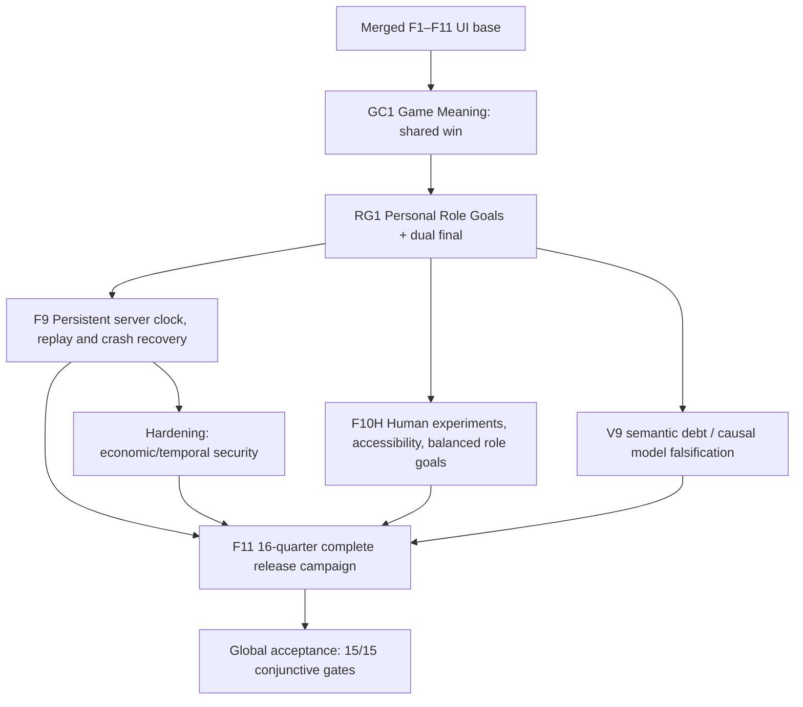

# CIE roadmap reticulum after RG1 · toward a genuinely publishable game

## Merged and local state

- F1–F8, F8bis, F10 Visible World, F11 Focus **merged** on `main` at `178789e21bf7548352b58088e39ab881a0a58d2a`.
- Game Clarity 40-game research + 32 failure classes: verified local predecessor, not merged.
- **RG1 Dual Goals**: next cumulative semantic PR. Source-layer simulation remains F7; personal missions are observer-scoped projections of owned actions and public measures.

## Dependency reticulum

## Remaining streams / meaningful Definition of Done

| Stream | Executable DoD | Primary falsifier | Relative weight (uncalibrated) |
|---|---|---|---:|
| F9 Persistent World | Durable authoritative server ticks, idempotent event application, clock-skew and crash replay recovery; offline browser catch-up exact | 24h simulation, duplicate jobs, crash before/after commit, offline rejoin, no wallet exploitation | 13 |
| F10H Human Engagement and Accessibility | >=20 actual players across all five roles, measured understanding, agency, fun and cognitive effort; assistive technologies, difficulty rebalance | Pre-registered thresholds not reached; accessibility defects unresolved | 13 |
| F11 Product Closure | Five 16-quarter campaigns, differentiated endings, full UI delivery, security, data retention, licenses, supply chain, deploy | clean builds, offline/online replay, >500 complete paths, E2E QA, risk review | 21 |
| V9/Economic semantic debt lane | Scope 1,037 V9 cases as data/provenance, validate 37 curated cases against mechanisms; remove invented realism; cross-ledger reconciliation | falsifier per case, counterfactual and adverse response, all ledger entries balanced | cross-cutting |
| Instrumentation/playtest lane | No dark patterns; privacy-preserving consented telemetry, player interviews, ability to opt out | abandonment study, comprehension, anti-coercion review | cross-cutting |

**Nominal 47 relative units** for F9/F10H/F11, excluding cross-cutting debt. A 13-unit risk reserve is suggested; these are sizing scores, not calendar forecasts.

## Fifteen global non-compensable gates

G01 one canonical world; G02 reproducible replay; G03 five 16-quarter campaigns; G04 auditable institutional legality and remedy; G05 scoped information and privacy; G06 consolidated economy and double-entry assets/debt; G07 V9 traceability with executable curated cases; G08 causal edges, feedback and falsifiability; G09 bounded strategic NPCs; G10 accessible European Atlas and role-consistent UX; G11 end-to-end QA and performance; G12 licensed and secure deploy with reproducible build; G13 server-authoritative durable asynchronous time; G14 demonstrated human comprehension and enjoyment; G15 complete coherent design system and visual progression.

RG1 improves G09/G10 (and legibility of G03) without closing them globally. **No equivalence** between synthetic campaigns and real-world effectiveness, or between UI metrics and fun, is asserted. Global PASS requires every gate.
